# BT-Analyzer

## Introduction

[中文](README.md)

BT-Analyzer is a transcription tool built on Demucs and Basic Pitch. I mainly built it to speed up my own guitar learning workflow, so a lot of work went into fretboard transcription and fingering display. The player also includes a few practice-friendly features.

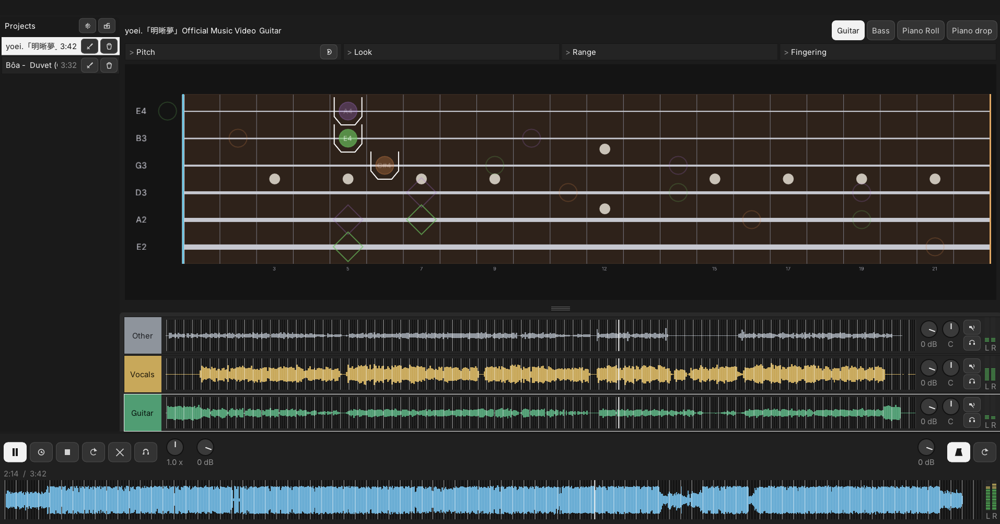

The current version has been rewritten with C++, ONNX Runtime, and Dear ImGui. On Windows 11 it has been tested as unzip-and-run. If you hit problems or have suggestions, feel free to open an Issue or contact me.

## Features

- **AI stem separation**: After import, BS-RoFormer SW splits a song into six stems (drums, bass, other, vocals, guitar, piano). Place the weights in `models` yourself; release zips do not include them.
- **Mixer**: Adjust gain, pan, mute, and solo per stem in real time
- **Practice player**: Variable speed, A-B loop, and count-in
- **Automatic beats**: The metronome can estimate the song’s beat and follow a floating BPM
- **AI transcription**: Each stem can be turned into notes for learning by ear
- **Multi-instrument note view**: Guitar, bass, Piano Roll, and piano drop
- **Guitar / bass fretboard**: Suggested positions, open strings, harmonics, and alternate fingerings on the fretboard

## Quick start

### 0. Download

1. Open the [Releases page](https://github.com/liaochikon/BT-Analyzer/releases).
2. Find the latest release and, under Assets, download `BT-Analyzer-*-win64.zip` (do not download Source code).
3. Extract the whole zip into a folder and open `bt-app.exe` inside it.
4. If Windows says “Windows protected your PC”, choose More info, then Run anyway.

Keep the whole folder together; `bt-app.exe` needs the files next to it.

### 1. Open a project

Drop a new song onto the window, or use Import.

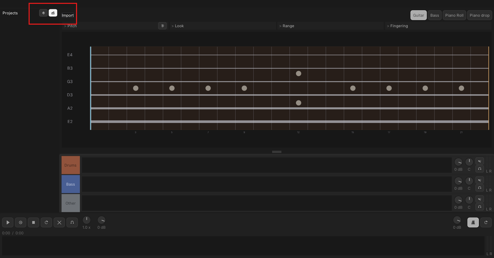

After import, stem separation and transcription run automatically. When the progress finishes, you can use the project.

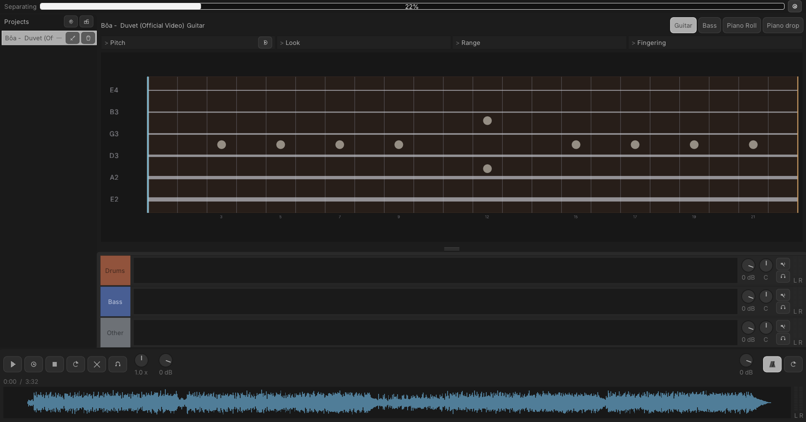

Processed projects appear in the project list, so next time you can open them directly without running again.

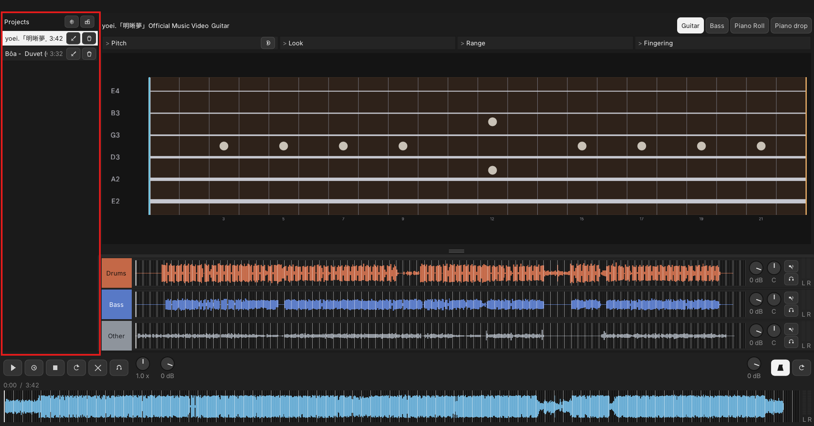

### 2. Stem mixer

After separation and transcription, the song shows up as a six-stem mixer.  
Each stem can be adjusted independently for gain, pan, mute, and solo. Click a stem to highlight it (right-click a knob to reset). The note view above shows the notes transcribed for that stem.

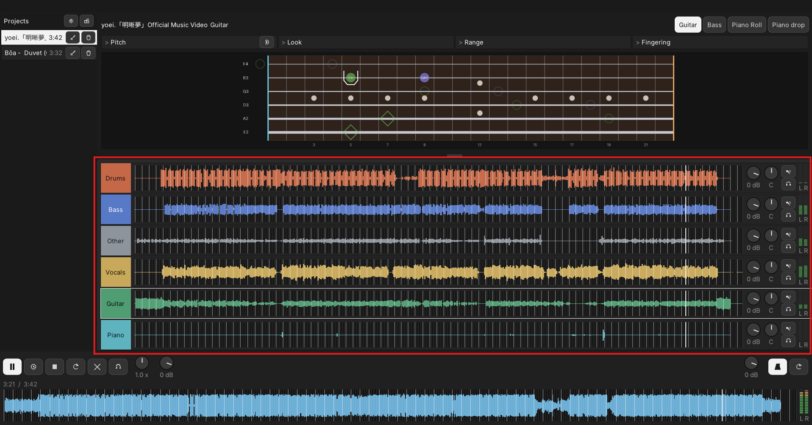

### 3. Note view

Above the mixer is the note view.

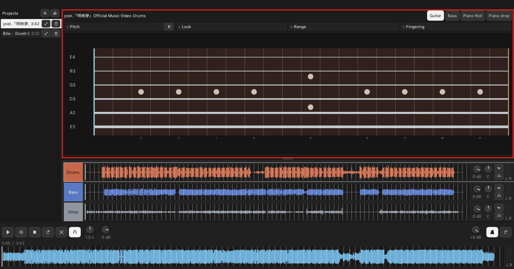

Use the buttons above to switch note-view modes.

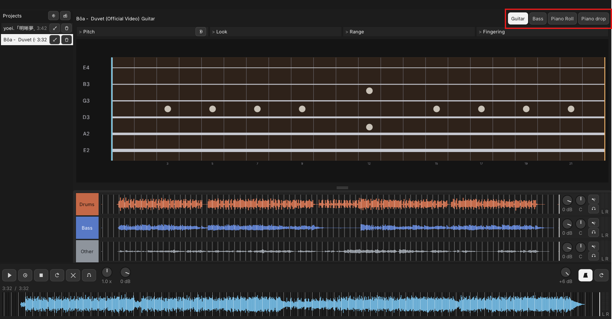

Currently supported: guitar, bass, Piano Roll, and piano drop.

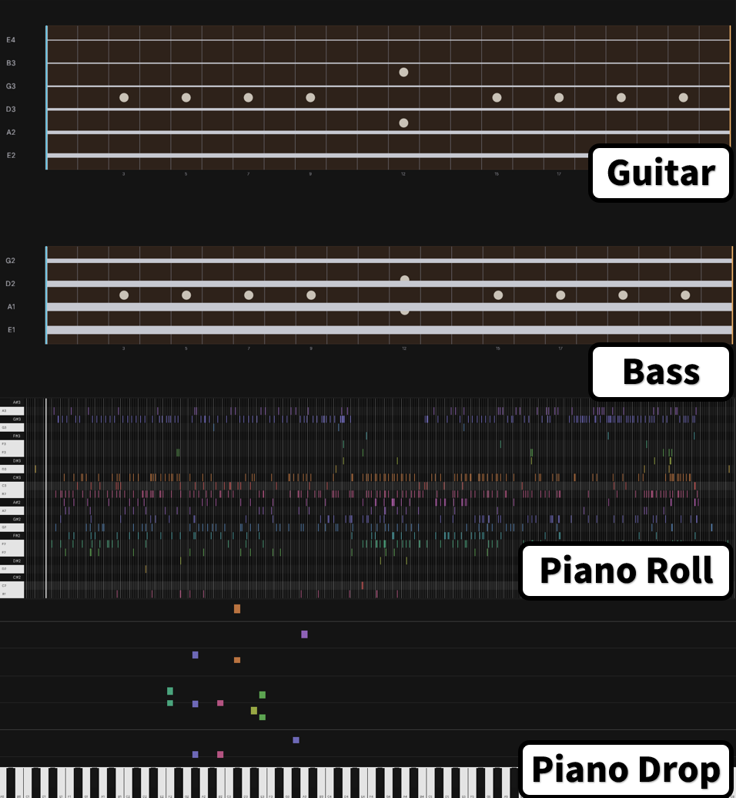

Each mode has more detailed settings, such as preferred guitar position, displayed pitch range, or transcription model parameters.

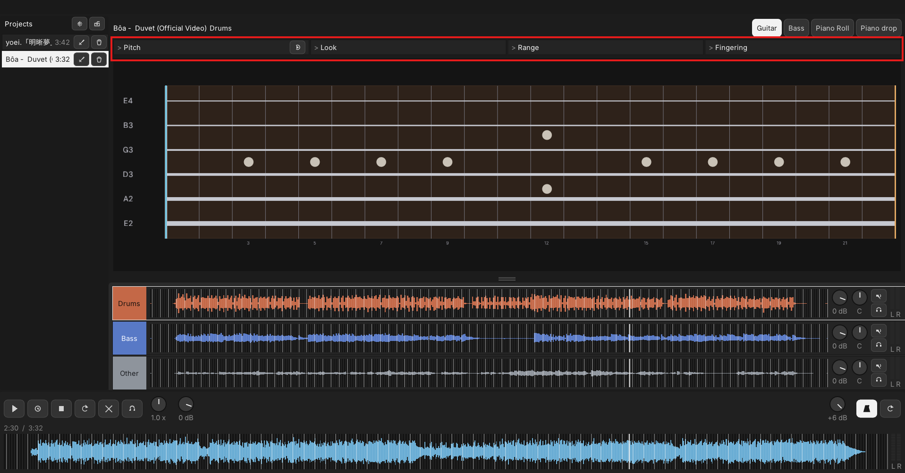

### 4. Player

The bottom section is the main player for song playback.

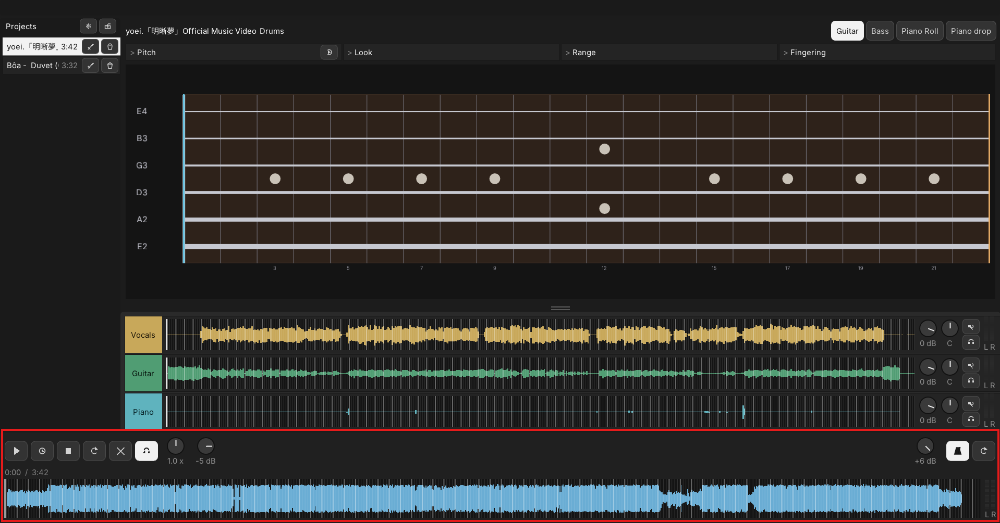

On the left are the main transport controls, left to right: play / pause, count-in, stop, A-B loop, clear A-B loop region, snap A-B loop to beats, playback speed, and master volume.  
On the right is the metronome. When a song is imported, beat times are calculated and the metronome is turned on. Left to right: metronome volume, metronome on/off, and redetect beats.

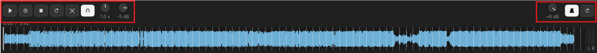

The waveform below works as a scrubber: left-drag to seek, right-click to set the A-B loop region.

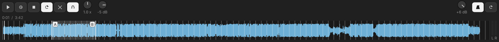

## Build

You need Windows 10/11 (64-bit), Visual Studio 2022 (MSVC), and CMake. The transcription model also needs Python 3.10+.

Place a BS-RoFormer SW ONNX file at `models/bs_roformer_sw.onnx` (`bs_roformer_sw_6stem_fp32.onnx` or `bs_roformer_sw_6stem_fp16.onnx` also work). The file is gitignored, and the `build.bat` zip does not include it. Inputs are `spec_real` and `spec_imag`, shape `[1, 2, 1025, T]`. Outputs are `out_spec_real` and `out_spec_imag`, shape `[1, 6, 2, 1025, T]`, with `T` fixed. The chunk length is `(T - 1) × 512`. The UVR setting of 588800 samples is `T = 1151`. A 4-second export with `T = 345` also loads, with a coarser separation.

```bat
python tools/fetch_nmp_onnx.py
build.bat
```

Output: `dist\BT-Analyzer-<version>-win64.zip`. The version number is in `VERSION`. The zip includes the transcription model and omits the separation weights.

## License

[MIT](LICENSE). Third-party licenses: `packaging/THIRD_PARTY_LICENSES.txt`.
