# BT-Analyzer

## 簡介

[English](README.en.md)

BT-Analyzer 是基於 Demucs 和 Basic Pitch 的轉譜工具，主要用來加速我的吉他抓歌流程，所以針對吉他指板的抓譜和彈奏位置顯示做了蠻多工作；此外，也在播放器裡加入一些方便練歌的功能。

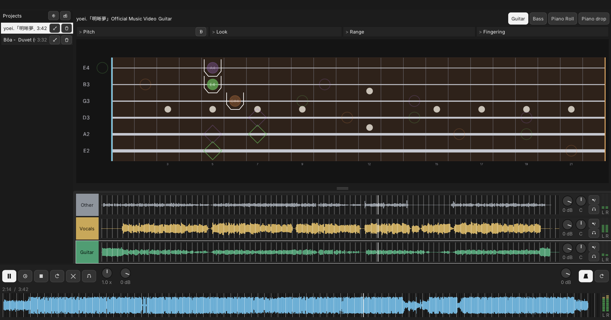

目前版本已用 C++、ONNX Runtime 和 Dear ImGui 重構，在 Windows 11 測試可直接解壓縮即用。若使用上有問題或建議，歡迎留 Issue 或聯絡我。

## 特色

- **AI 分軌**：匯入音樂後可自動拆成六軌（鼓、貝斯、其他、人聲、吉他、鋼琴）
- **混音控制**：即時調整各音軌音量、左右（pan）、靜音、獨奏
- **多功能播放器**：支援變速播放、AB 循環、數四拍
- **自動節拍**：節拍器可自動推算歌曲節拍，支援浮動 BPM
- **AI 轉譜**：各音軌可自動轉成音符，方便抓歌參考
- **多樂器音符顯示**：支援吉他、貝斯、Piano Roll、鋼琴下落
- **吉他／貝斯指板**：可在指板上顯示建議把位、空弦、泛音、其他可能彈奏位置

## 快速上手

### 0. 下載

1. 打開 [Releases 頁面](https://github.com/liaochikon/BT-Analyzer/releases)。
2. 找到最新一版，在 Assets 底下下載 `BT-Analyzer-*-win64.zip`（不要下載 Source code）。
3. 把整個壓縮檔解壓成一個資料夾，打開裡面的 `bt-app.exe`。
4. 若 Windows 顯示「已保護你的電腦」，選「其他資訊」，再選「仍要執行」。

請整份資料夾一起保留；`bt-app.exe` 要靠旁邊的檔案才能開。

### 1. 開啟專案

把新歌曲拖進視窗，或按匯入。

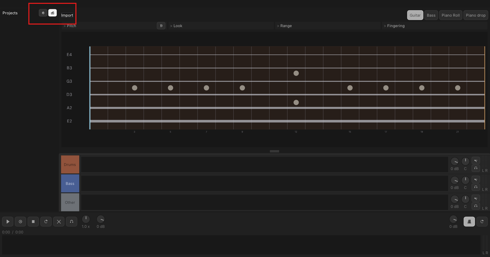

匯入後會自動分軌並轉譜，等進度跑完即可開始使用該專案。

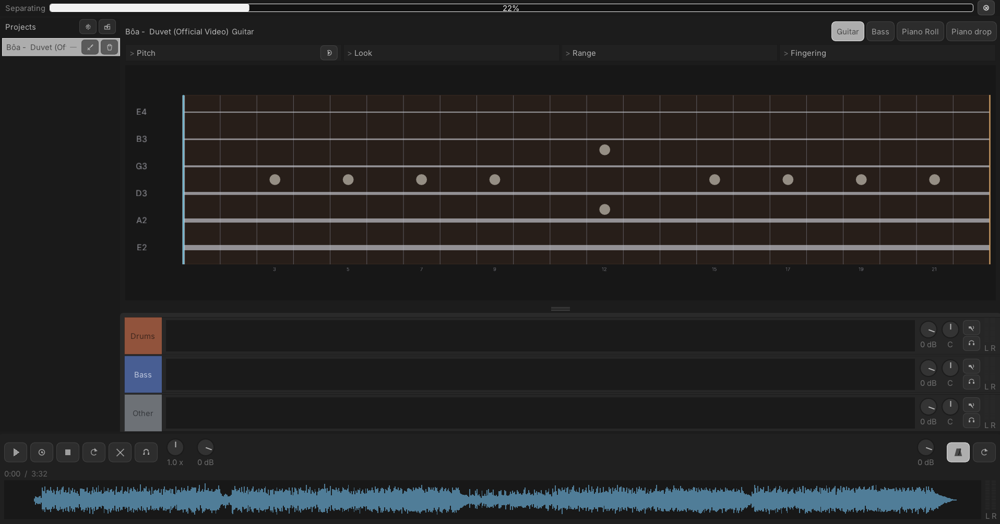

處理過的專案會出現在專案列表，下次可直接開啟，不用再跑一次。

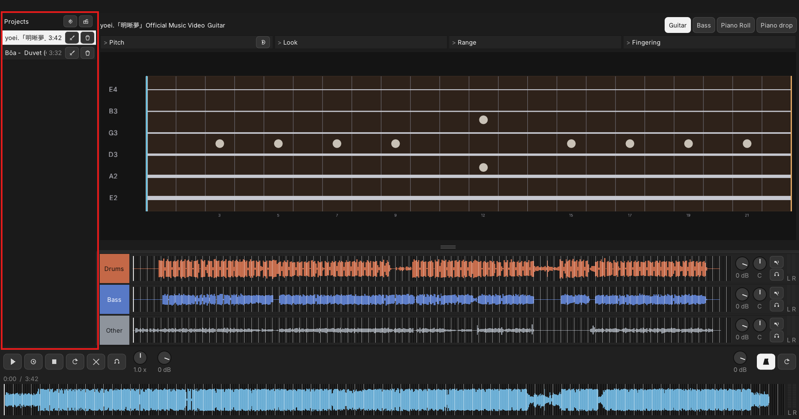

### 2. 音軌混音

分軌並轉譜完成後，會以六軌混音器呈現。  
各音軌可獨立調整音量、pan、靜音、獨奏。點選某個音軌後會高亮（旋鈕按右鍵可重置），上方的音符顯示會對應到該音軌已轉出的音符。

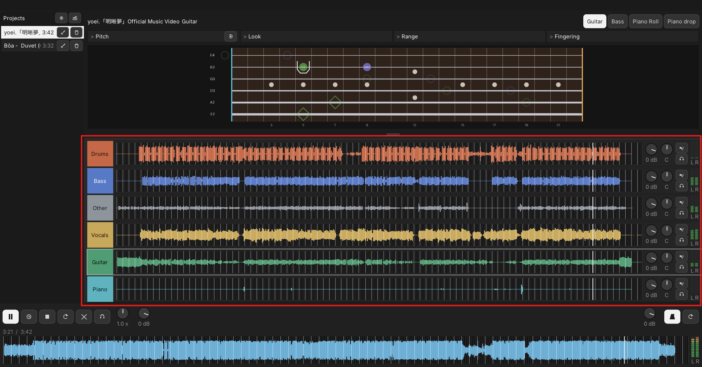

### 3. 音符顯示

混音器上方是音符顯示視窗。

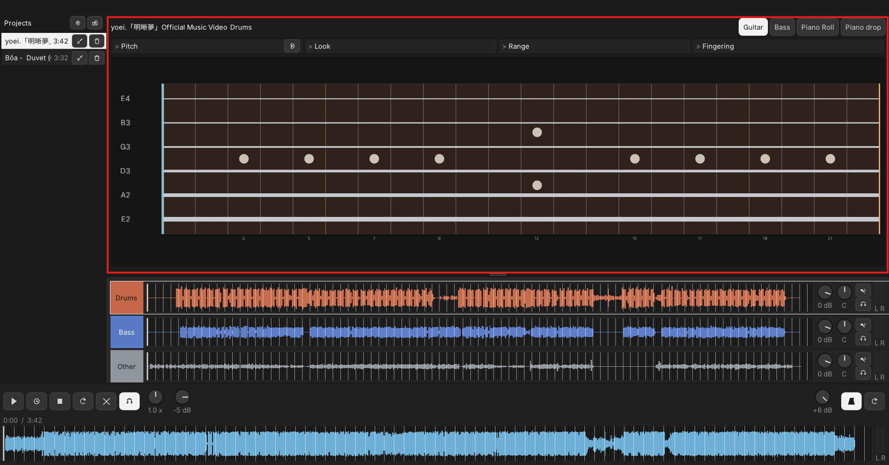

上方按鈕可切換音符顯示方式。

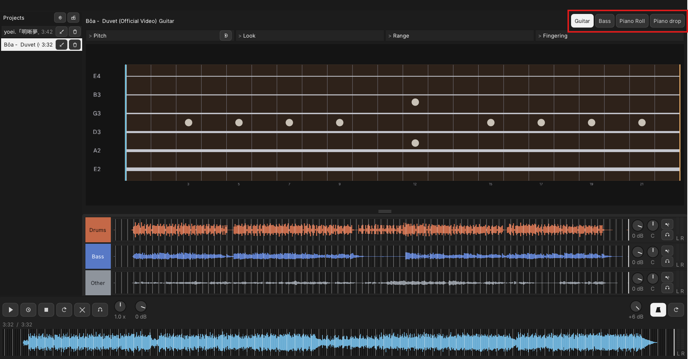

目前支援吉他、貝斯、Piano Roll、鋼琴下落。

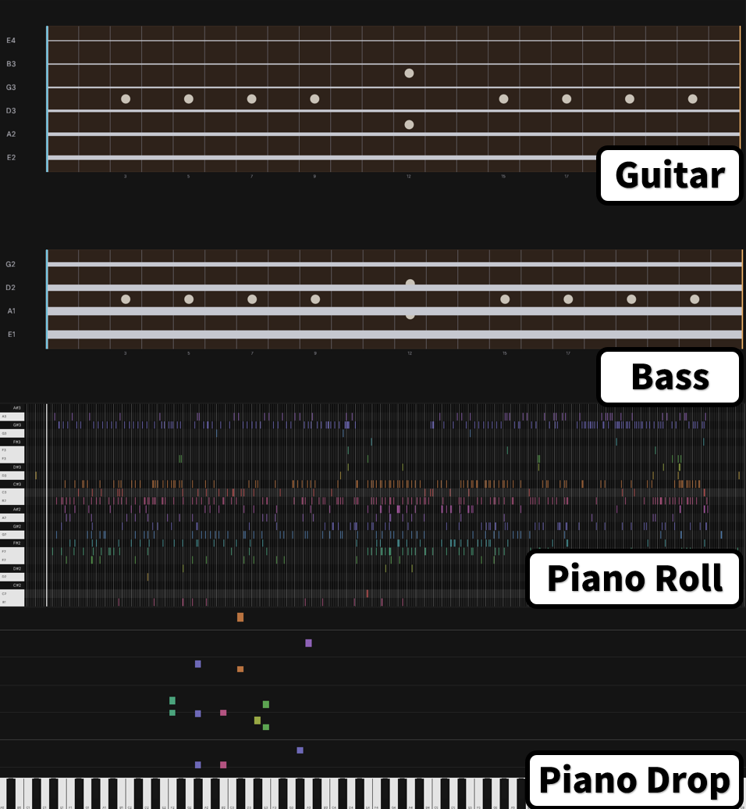

每種音符顯示都有更細的設定，例如吉他的偏好把位、顯示的音符範圍，或轉譜模型參數。

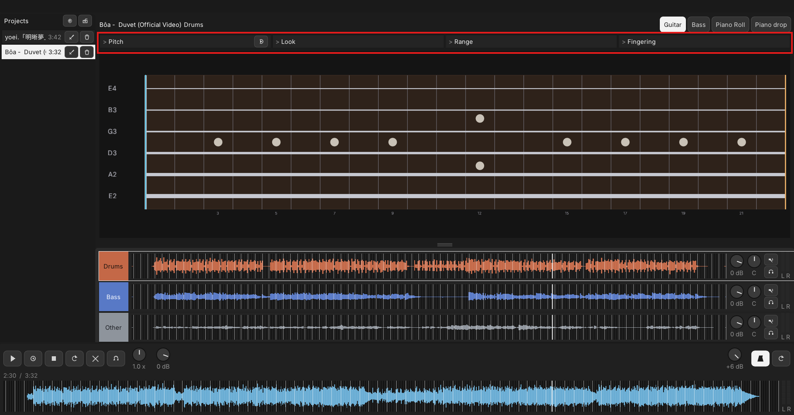

### 4. 播放器

下方區塊是主播放器，用來控制歌曲播放。

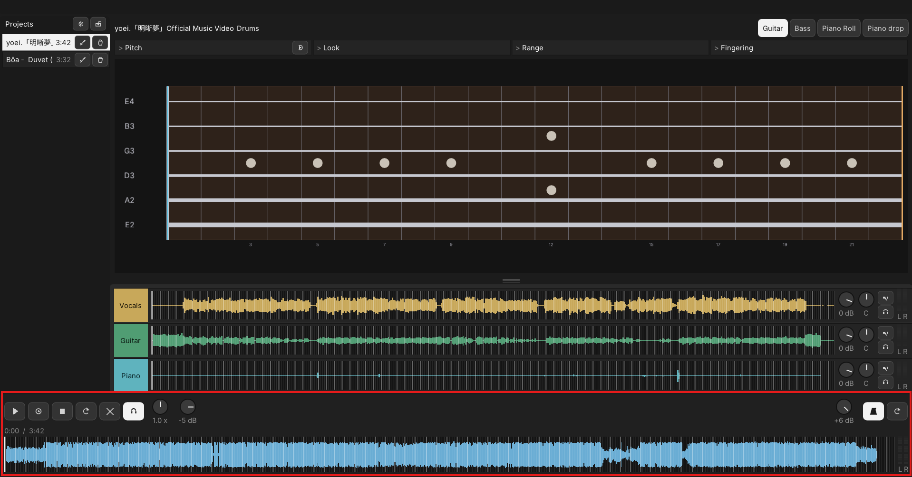

左邊是主要播放控制，由左至右為：播放／暫停、數四拍、停止、AB 循環、清除 AB 循環區段、AB 循環對拍、播放速度、總音量。  
右邊是節拍器，匯入歌曲時會自動計算拍點並開啟節拍器，由左至右為：節拍器音量、節拍器開關、重測拍點。

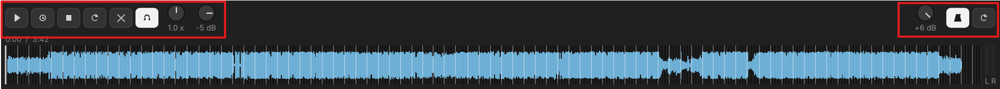

下方波形可當作進度條：左鍵拖曳播放進度，右鍵設定 AB 循環區段。

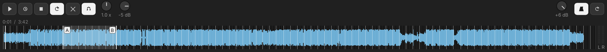

## 建置

需要 Windows 10/11（64 位元）、Visual Studio 2022（MSVC）、CMake。模型匯出另需 Python 3.10+。

```bat
python tools/fetch_nmp_onnx.py
python -m pip install "demucs-onnx[export]==0.3.4" "onnxruntime>=1.20" soundfile
python -m htdemucs6s_onnx export models/htdemucs_6s.onnx
build.bat
```

產出：`dist\BT-Analyzer-<版本>-win64.zip`。版本號在 `VERSION`。

## 授權

[MIT](LICENSE)。第三方見 `packaging/THIRD_PARTY_LICENSES.txt`。
